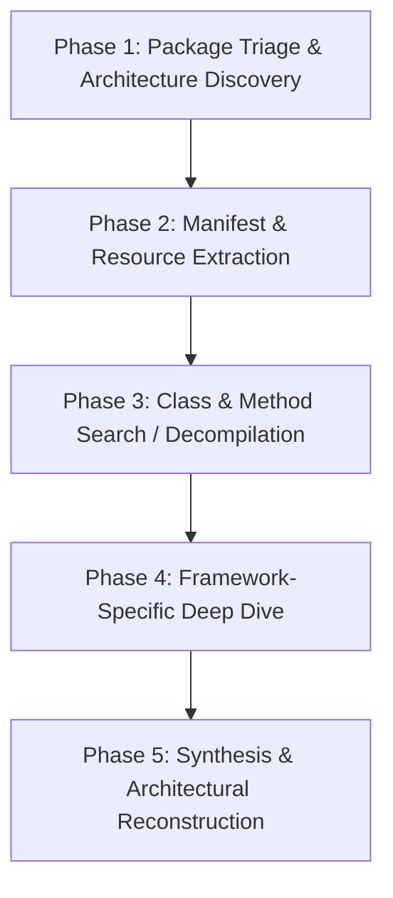

# AI Agent APK & Android Reverse Engineering Pipeline & Tool Manual

This document provides a standard operating procedure and pipeline for an **AI Agent / Bot** to autonomously analyze, decompile, and reverse engineer Android applications (`.apk` and `.aab` packages) using the tools and infrastructure in this repository.

---

## 1. Directory Contents & Architecture

This folder (`apk_re_4_bot/`) contains the necessary modules, contracts, services, and operational guides for Android reverse engineering:

| Component / File                    | Purpose & Role                                                                                                                                |
| :---------------------------------- | :-------------------------------------------------------------------------------------------------------------------------------------------- |
| `PIPELINE.md`                       | Complete 5-phase reverse engineering pipeline for any APK                                                                                     |
| `android-applications.md`           | Core JADX/Java runtime constraints, JVM heap, and headless rules                                                                              |
| `registerAndroidTools.ts`           | MCP tools: `inspect_android_package`, `search_android_classes`, `inspect_android_class`, `inspect_android_method`, `trace_android_references` |
| `registerApktoolTools.ts`           | MCP tools: `inspect_apktool_client`, resources/assets & manifest decoding                                                                     |
| `registerFlutterTools.ts`           | MCP tools: Flutter APK detection, Dart AOT snapshot & engine analysis                                                                         |
| `registerAdbTools.ts`               | MCP tools: `inspect_adb_device`, live device/emulator target observation                                                                      |
| `AndroidAnalysisService.ts`         | Application service driving headless JADX MCP analysis                                                                                        |
| `AndroidPackageInspection.ts`       | Extracts package name, target SDK, permissions, components, digests                                                                           |
| `AndroidSearchEvidenceSummary.ts`   | Fast class/symbol discovery across DEX files                                                                                                  |
| `ApktoolResourceAnalysisService.ts` | Decompiled XML resources, layout files, drawables, `strings.xml`                                                                              |
| `FlutterBuildAnalysisService.ts`    | Identifies Flutter/Dart binary blobs (`libapp.so`, `libflutter.so`)                                                                           |
| `DartAotInspection.ts`              | Inspects Dart AOT symbols and Flutter runtime versions                                                                                        |

---

## 2. Five-Phase APK Reverse Engineering Pipeline for AI Agents

When an AI agent is tasked with reverse engineering an APK, it follows this 5-phase systematic workflow:

### Phase 1: Package Triage & Architecture Discovery

- **Goal:** Verify file integrity, extract metadata, and identify the underlying architecture (Native Java/Kotlin, Flutter, React Native, Unity).
- **Tools:**
  - `inspect_android_package`: Supply the absolute APK path. Extract package ID, versionCode, compileSdkVersion, main Application/Launcher activity, and permissions.
  - `inspect_flutter_build`: Check whether the APK contains Flutter/Dart AOT libraries (`libapp.so`, `libflutter.so`).
- **Agent Rule:** Never execute or launch untrusted APKs directly on the host machine. Analysis is strictly static and headless.

### Phase 2: Manifest & Resource Extraction

- **Goal:** Inspect decoded AndroidManifest.xml, network security configurations, and app resources.
- **Tools:**
  - `inspect_apktool_client`: Inspect resource decoding and asset trees.
  - Search `res/xml/network_security_config.xml` for cleartext traffic rules, custom trust anchors, or SSL pinning configs.
  - Inspect `strings.xml` and metadata for API keys, backend base URLs, Firebase endpoints, and third-party SDK tokens.

### Phase 3: Class & Method Search / Decompilation (JADX Engine)

- **Goal:** Locate high-value business logic, network client implementations, encryption helpers, and data models.
- **Tools:**
  - `search_android_classes`: Find candidate classes matching keywords (e.g., `*Auth*`, `*Api*`, `*Repository*`, `*Crypto*`, `*Token*`).
  - `inspect_android_class`: Inspect fields, method signatures, constructors, and annotations for the selected class.
  - `inspect_android_method`: Decompile Dalvik bytecode into clean Java source for a specific method. If multiple overloads exist, specify `overload_index`.
  - `trace_android_references`: Trace callers and incoming static references to identify where a method or secret is used.

### Phase 4: Framework-Specific Deep Dive

Depending on the tech stack discovered in Phase 1:

- **Java / Kotlin Native:**
  - Trace Retrofit/OkHttp interfaces, Room databases, and ViewModel logic.
- **Flutter:**
  - Use `inspect_dart_aot` and native ELF inspection on `libapp.so` to extract Dart symbols, string constants, and route tables.
- **React Native:**
  - Extract `assets/index.android.bundle` and feed it into JavaScript AST recovery (`recover_javascript_sources`).
- **Native C/C++ Libraries (`lib/*.so`):**
  - Use REA's native ELF/Ghidra/Hopper providers to decompile JNI bindings (`Java_com_...`).

### Phase 5: Synthesis & Reconstruction

- **Goal:** Synthesize the reverse engineering findings into actionable documentation:
  1. **Component Mapping:** Activities, Services, Broadcast Receivers, Content Providers.
  2. **API & Network Endpoints:** Full list of discovered URLs, parameters, headers, and authentication tokens.
  3. **Security Posture & Findings:** Hardcoded credentials, insecure crypto algorithms, exported components without permissions.
  4. **Business Logic Summary:** Step-by-step description of core algorithms, payment flows, or token refresh logic.

---

## 3. Host Prerequisites & Environment Variables

- **Java Version:** Java 17 or newer (`JAVA_HOME` pointing to JDK root).
- **JADX MCP Engine:** Point `REA_JADX_MCP_JAR` to the headless JADX MCP jar (`jadx-mcp-server-0.7.1.jar`).
- **Optional Memory Tuning:** Set `REA_JADX_HEAP_MIB` (e.g. `2048` or `4096`) for large multi-DEX APKs.
