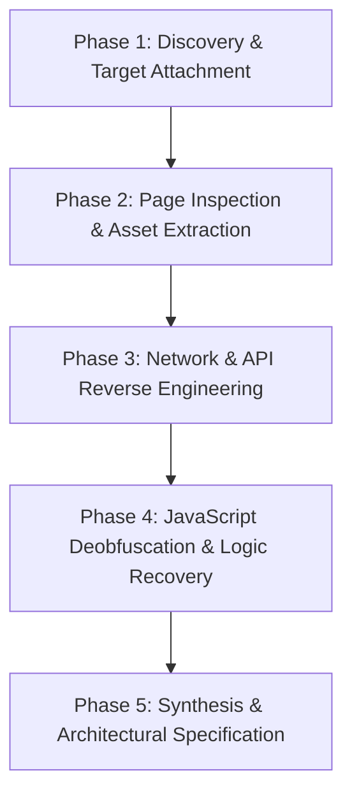

# AI Agent Web Reverse Engineering Pipeline & Tool Manual

This document provides a complete guide and standard operating procedure for an **AI Agent / Bot** to reverse engineer web links, web pages, single-page applications (SPAs), APIs, and full websites using the tools and infrastructure included in this workspace.

---

## 1. Directory Contents & Architecture

This folder (`site_re_4_bot/`) contains all key modules, interfaces, and operational guidelines needed for autonomous web reverse engineering:

| Component / File                   | Purpose & Role                                                                                                                                       |
| :--------------------------------- | :--------------------------------------------------------------------------------------------------------------------------------------------------- |
| `PIPELINE.md`                      | Step-by-step workflow for the AI agent to analyze any URL/site                                                                                       |
| `runtime-observation.md`           | Browser and Electron runtime observation reference guide                                                                                             |
| `javascript-applications.md`       | Decompilation, source recovery, and AST module tracing guide                                                                                         |
| `registerBrowserTools.ts`          | MCP tools: `list_browser_targets`, `inspect_web_page`, `analyze_web_bundle`, `observe_web_session`, `capture_web_screenshot`, `compare_web_captures` |
| `registerBrowserScenarioTool.ts`   | MCP tool: `capture_browser_scenario` for agent-driven automated actions                                                                              |
| `registerWebNetworkCaptureTool.ts` | MCP tool: `inspect_web_network_capture` (HAR, SAZ, fetch logs)                                                                                       |
| `registerWebScriptTool.ts`         | MCP tool: `export_web_scripts` for extracting client-side JS/TS sources                                                                              |
| `registerWebModuleTool.ts`         | MCP tool: `trace_web_module_imports` for module dependency graph                                                                                     |
| `registerWebRuntimeTools.ts`       | MCP tools: `observe_web_execution`, `inspect_web_event_listeners`                                                                                    |
| `registerWebSourceLocationTool.ts` | MCP tool: `trace_web_source_location` for mapping transpiled/minified JS to source locations                                                         |
| `BrowserObservationService.ts`     | Backend service implementation for page and bundle inspection                                                                                        |
| `BrowserScenarioCaptureService.ts` | Automation service executing user/agent steps on headless or attached browser                                                                        |
| `WebNetworkCaptureService.ts`      | Network analyzer parsing requests, headers, query params, WebSocket and API traces                                                                   |
| `WebScriptExportService.ts`        | Service isolating and exporting cached and live client scripts                                                                                       |
| `WebRuntimeService.ts`             | Execution listener inspection & runtime telemetry engine                                                                                             |
| `WebModuleTraceService.ts`         | ES module, CommonJS, and AMD dependency tracer                                                                                                       |
| `WebSourceLocationService.ts`      | Source map locator, mapping minified symbols back to source files                                                                                    |

---

## 2. Five-Phase Reverse Engineering Pipeline for AI Agents

When an AI agent receives a link or website target, it should execute the following 5 phases sequentially:

### Phase 1: Discovery & Attachment

- **Goal:** Connect to the browser CDP instance or launch a clean headless session.
- **Tools:**
  - `list_browser_targets`: Scan open pages or Electron webviews.
  - Choose `connect` mode (loopback CDP `http://127.0.0.1:9222`) or `launch` mode for isolated runs.
- **Agent Rule:** Always record the `target_id` and origin scope to prevent cross-origin leaks.

### Phase 2: Page Inspection & Asset Extraction

- **Goal:** Capture the live DOM, accessibility tree, storage keys, and script inventories.
- **Tools:**
  - `inspect_web_page`: Extract document structure, metadata, inline scripts, external script URLs, CSS sheets, and storage keys (`localStorage`, `sessionStorage`, `cookies`).
  - `export_web_scripts`: Dump all discovered `<script>` tags, inline JS chunks, and dynamically injected worker scripts into local files for static analysis.
  - `capture_web_screenshot`: Save high-resolution visual evidence of states.

### Phase 3: Network & API Reverse Engineering

- **Goal:** Intercept and map all backend endpoints, authentication flows, and data contracts.
- **Tools:**
  - `observe_web_session`: Record full HTTP(S) request/response exchanges, GraphQL queries, WebSocket messages, query parameters, and Link headers.
  - `inspect_web_network_capture`: Analyze `.har` or `.saz` capture files.
  - `capture_browser_scenario`: Perform programmatic actions (e.g., clicking buttons, submitting forms, scrolling) and record the triggered network traffic.
- **Agent Analysis Tasks:**
  1. Identify REST / GraphQL endpoint patterns (`/api/v1/...`).
  2. Map request headers, CSRF tokens, bearer tokens, or session cookies.
  3. Reverse engineer JSON request and response payloads, building TypeScript schema definitions.

### Phase 4: JavaScript Deobfuscation & Logic Recovery

- **Goal:** Turn minified web bundles (Webpack, Vite, Rollup, Turbopack) into understandable logic.
- **Tools:**
  - `analyze_web_bundle`: Check for embedded Source Maps (`.map`), virtual file trees, and known libraries.
  - `trace_web_source_location`: Locate source files corresponding to specific stack traces or error locations.
  - `trace_web_module_imports`: Map relationships between internal modules, vendor chunks, and dynamic imports.
  - `inspect_web_event_listeners`: Locate click/input event handlers attached to specific DOM selectors without firing events.
  - `observe_web_execution`: Profile exact functions and code paths triggered during execution.

### Phase 5: Synthesis & Reconstruction

- **Goal:** Produce a complete reverse-engineered specification of the target web application.
- **Output Artifacts to generate:**
  1. **Frontend Component Architecture:** UI tree, layout, CSS variables/tokens, and state management flow.
  2. **API Specification:** OpenAPI 3.0 / Swagger schema of all discovered endpoints.
  3. **Business Logic & Auth Flow:** Step-by-step description of encryption, tokens, validation rules, and algorithms.
  4. **Clean Clone / Re-implementation Code:** Clean-room re-implementation of the target service or client.

---

## 3. Best Practices & Invariants for the AI Agent

1. **Passive First:** Always run passive inspection (`inspect_web_page`, `observe_web_session`) before firing interactive scenarios.
2. **Never Execute Untrusted Code Direct in Host:** Only inspect extracted JavaScript via AST analysis or isolated headless sandboxes.
3. **Preserve Evidence Provenance:** Always record the URL, timestamp, HTTP status codes, and script sha256 digests.
4. **Redact Sensitive Secrets:** Redact actual user passwords, private API keys, and authorization bearer tokens from persistent reports.
